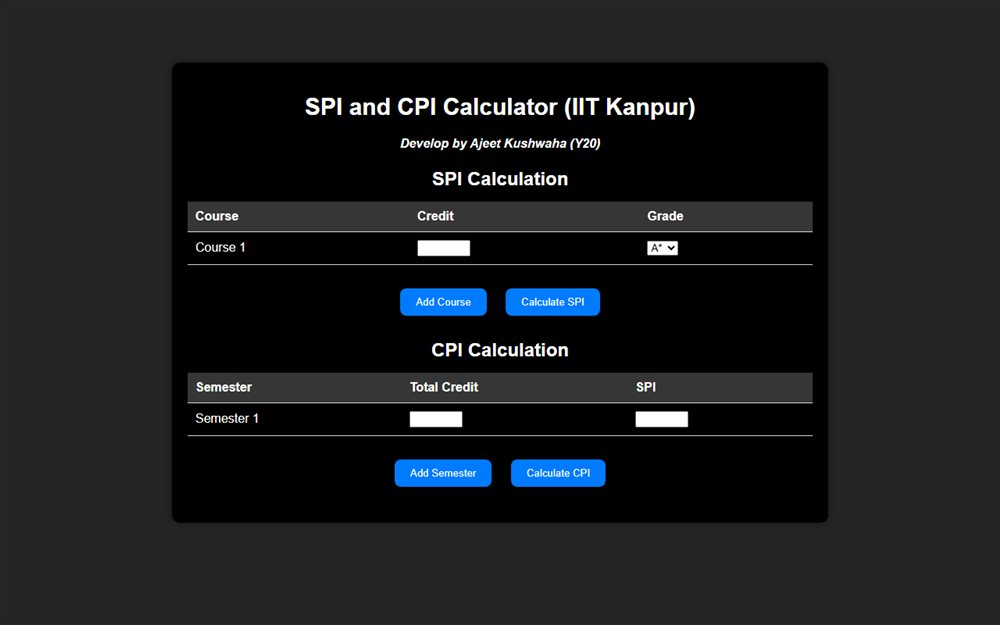

# SPI & CPI Calculator

The companion calculator to SPI Calculator: enter marks and credits once, read both the semester and cumulative index.

**[Open the live site](https://ajeet-iitk.github.io/cpi/)**

## What it does

An SPI/CPI calculator for IIT-style grading. Courses are entered with a credit value and a grade; the page weights each grade by its credits and returns the index. This build keeps the calculation logic in `cpi.js` so the two pages share one implementation.

## Features

- Credit-weighted SPI and CPI calculation
- Course rows added on demand
- Calculation isolated in `cpi.js` - easy to read and change
- Custom favicon and its own stylesheet

## Run locally

Open `index.html`, or use the hosted copy:

<https://ajeet-iitk.github.io/cpi/>

## Files

| File | Purpose |
| --- | --- |
| `index.html` | SPI view |
| `CPI.html` | CPI view |
| `cpi.js` | Shared calculation logic |
| `cpi_style.css` | Styling |
| `favicon.ico` | Site icon |

---

Part of [my collection of small projects](https://github.com/Ajeet-iitk).
